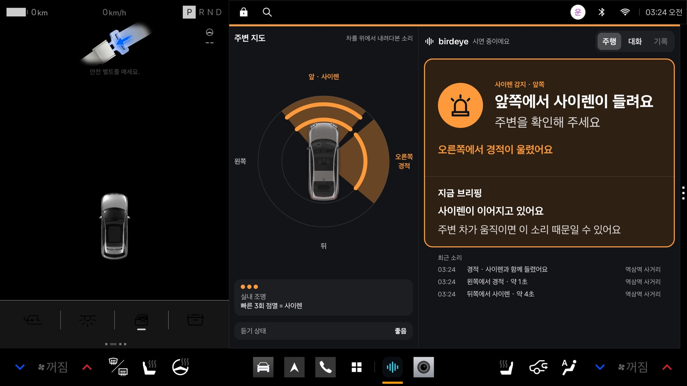
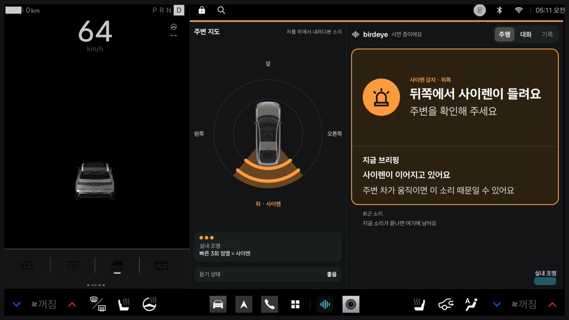
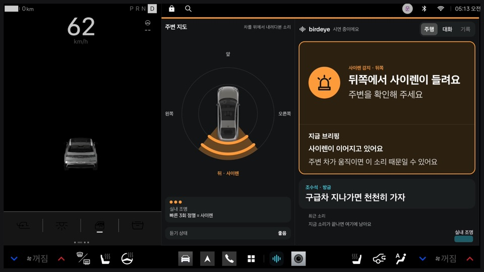
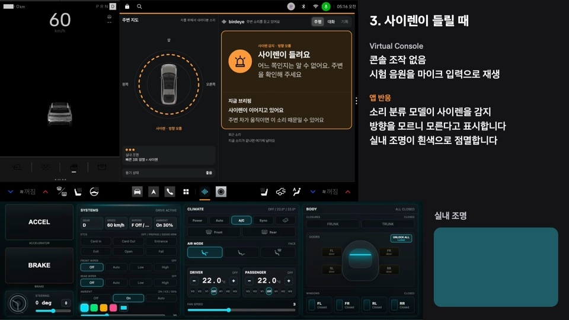
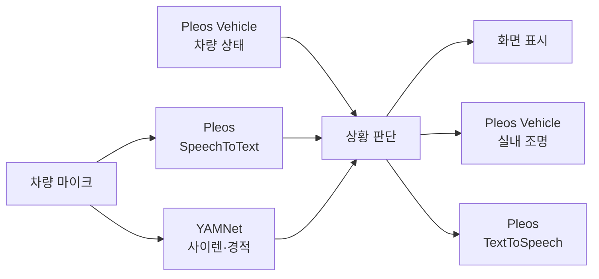

# birdeye

청각장애·난청 운전자를 위한 Pleos Connect 주변상황 브리핑 앱입니다. 차량 마이크로 들은 사이렌, 경적, 사람의 말을 화면의 지도와 문장, 실내 조명으로 알립니다.



<sub>Pleos Connect 에뮬레이터, 데모 모드</sub>

## 배경

| | |
| --- | --- |
| 56.0% | 사이렌을 알아채지 못한 경험이 있는 청각장애 운전자 비율 (비교군 10.4%) [1] |
| 59.10° | 심도 난청인의 경적 방향 판단 오차 (정상 청력 8.27°) [2] |
| 40.4% | 다른 차의 움직임을 보고 긴급차가 온 줄 착각한 경험이 있는 청각장애 운전자 비율 [1] |

## 데모 영상

Pleos Connect 에뮬레이터 화면입니다. 영상에는 소리가 없습니다.

| 1. 혼자 운전할 때 (1:42) | 2. 동승자와 함께 (1:34) | 3. Virtual Console 연동 (1:17) |
| :---: | :---: | :---: |
| [](https://github.com/HMG-KJP/birdeye/releases/download/demo-videos/birdeye_demo_alone.mp4) | [](https://github.com/HMG-KJP/birdeye/releases/download/demo-videos/birdeye_demo_passenger.mp4) | [](https://github.com/HMG-KJP/birdeye/releases/download/demo-videos/birdeye_demo_console.mp4) |

<details>
<summary>1. 혼자 운전할 때</summary>

1. 뒤에서 사이렌이 들릴 때
2. 경적이 울릴 때
3. 사이렌과 경적이 함께 들릴 때
4. 비가 올 때
5. 확실하지 않은 소리가 들릴 때
6. 창밖에서 경찰이 말을 걸 때
7. 운행이 끝난 뒤

</details>

<details>
<summary>2. 동승자와 함께</summary>

1. 사이렌 중에 옆자리 사람이 말할 때
2. 옆자리 사람에게 답할 때
3. 경적이 울릴 때
4. 비 오는 날 대화할 때
5. 주차 안내원이 말을 걸 때
6. 옆자리 사람이 내릴 때
7. 운행이 끝난 뒤

</details>

<details>
<summary>3. Virtual Console 연동</summary>

데모 모드를 끄고 Virtual Console과 시험 음원으로 입력을 넣은 화면입니다.

1. 기어를 D로 넣을 때
2. 와이퍼를 켤 때
3. 사이렌이 들릴 때
4. 옆자리 사람이 말할 때
5. 주차하고 창문을 열 때
6. 옆자리 사람이 내릴 때

</details>

## 기능

| 상황 | 동작 |
| --- | --- |
| 사이렌·경적 | 실내 조명이 소리별 리듬으로 깜빡이고, 지도에 소리 난 쪽을 표시하고, "뒤쪽에서 사이렌이 들려요"처럼 알립니다 |
| 소리가 없을 때 | "사이렌과 경적은 들리지 않아요"라고 표시합니다 |
| 옆자리 사람의 말 | 자막으로 보여 주고, 답장 버튼을 누르면 차가 음성으로 말합니다 |
| 창밖 사람의 말 | 정차 중 운전석 창문을 열면 대화 화면으로 바뀝니다 |
| 문 열림·닫힘 | 어느 문이 열렸고 언제 닫혔는지 지도와 글자로 표시합니다 |
| 비·와이퍼·바람 | 소리를 놓칠 수 있다고 표시하고 감지 기준을 낮춥니다 |
| 운행 후 | 소리와 대화 기록을 시간·장소 순으로 봅니다 |
| 앱이 가려졌을 때 | 내비게이션이나 후진 카메라 화면 뒤에서도 듣기와 실내 조명이 동작합니다 |

## 동작 구조



말소리 인식, 음성 합성, 차량 정보, 실내 조명은 Pleos SDK를 씁니다. 사이렌·경적 분류는 Pleos SDK에 없어서 공개 모델인 YAMNet(TensorFlow Lite)으로 기기 안에서 처리합니다. 분류 결과와 차량 상태를 보고 화면과 조명으로 무엇을 알릴지는 앱 코드가 정합니다.

## 기술 스택

| 영역 | 사용 기술 |
| --- | --- |
| 언어·UI | Kotlin 2.0.0, Jetpack Compose, Kotlin Coroutines |
| 차량 연동 | Pleos Connect SDK: Vehicle 2.3.2, SpeechToText 3.3.1, TextToSpeech 3.3.1, FusedLocation 1.1.3 |
| 소리 분류 | YAMNet, TensorFlow Lite |
| 저장 | Room. 기기 안에만 저장하고 음성 원본은 저장하지 않습니다 |
| 백그라운드 | 마이크 포그라운드 서비스 |
| 테스트 | JUnit, Robolectric, Compose UI Test, Roborazzi, MockK |
| CI | GitHub Actions: push마다 단위 테스트와 릴리스 APK 빌드 |
| 빌드 | AGP 8.8.2, Gradle 8.10.2, JDK 17, minSdk 28, compileSdk·targetSdk 35 |

### Pleos SDK 사용 API

| SDK | API | 쓰는 곳 |
| --- | --- | --- |
| Vehicle · Gear | `registerGearSelection` | 주행·정차 판단, 주행 중 기록·설정 잠금 |
| Vehicle · Window | `registerWindowPosition` | 창문 대화 화면 전환 (20% 이상 열림) |
| Vehicle · Door | `registerDoorPosition` | 문 열림·닫힘 |
| Vehicle · Seat | `registerSeatOccupancy` | 자막의 좌석 표시 |
| Vehicle · Wiper, Light | `registerWiperState`, `registerFrontFogLightState`, `registerRearFogLightState` | 듣기 상태 |
| Vehicle · TurnSignal | `registerTurnSignalState` | 시스템 카메라 창이 뜨는 동안 카드 위치 조정 |
| Vehicle · Light | `setAmbientLightBrightness`, `setAmbientLightBrightnessColor` | 실내 조명 신호, 끝난 뒤 원래 값 복구 |
| SpeechToText | 온디바이스 모드, `sendAudio`, `ResultListener` | 자막 |
| TextToSpeech | `speak`, `EventListener` | 대신 말하기 |
| FusedLocation | `registerFusedLocationCallback` | 기록의 장소 |

이 밖에 Android `AudioRecord`(마이크 입력)와 `CarUxRestrictionsManager`(주행 중 화면 제한)를 씁니다. 비공개 API는 쓰지 않습니다.

### 디자인

Pleos Connect UI Design Guide와 공식 Figma를 따릅니다. Connect-S, W, WF 창 크기의 가로·세로 레이아웃과 주간·야간 테마를 지원합니다.

## 실행 방법

### 준비

1. Android Studio의 SDK Manager > SDK Update Sites에 Pleos Connect 시스템 이미지를 추가합니다.
   - Mac: `https://nexus-playground.pleos.ai/repository/raw-releases/connect-avd/2.x/crp-arm64-sys-img.xml`
   - Windows, Linux: `https://nexus-playground.pleos.ai/repository/raw-releases/connect-avd/2.x/crp-sys-img.xml`
2. Device Manager에서 Pleos Connect v2.1.0 AVD를 만듭니다. Default boot는 Cold, RAM은 4GB로 설정합니다.

### 빌드와 설치

```bash
./gradlew testDebugUnitTest     # 단위 테스트
./gradlew assembleRelease       # 서명 키가 없으면 디버그 키로 서명합니다
adb install -r -g app/build/outputs/apk/release/*.apk
```

GitHub Actions의 [Build](https://github.com/HMG-KJP/birdeye/actions/workflows/build.yml) 결과물(`birdeye-apk`)로도 설치할 수 있습니다. 자동차용(Automotive) 기기와 에뮬레이터에서만 설치됩니다.

앱은 사용자 10으로 실행됩니다. 명령줄에서는 `adb shell am start --user 10 -n app.birdeye/.MainActivity`로 엽니다.

### 데모 모드

1. 기어가 P인 상태에서 앱을 열고 **설정**을 누릅니다.
2. **데모 모드**를 켜고 **혼자 운전 재생** 또는 **동승자와 함께 재생**을 누릅니다.
3. 끝나면 **기록** 탭에서 기록을 확인합니다.

### 실제 입력

데모 모드를 끄면 차량 값과 마이크 입력으로 동작합니다. 차량 값은 에뮬레이터의 Virtual Console에서 바꿉니다(`adb forward tcp:8088 tcp:8088` 후 `http://127.0.0.1:8088`). 데모 영상 3이 이 방식으로 찍은 화면입니다.

## 참고

- 소리 방향은 데모 모드에서만 표시합니다. 에뮬레이터는 마이크 입력이 하나라 실제 입력에서는 "방향 모름"으로 표시합니다.
- 에뮬레이터와 시험 음원으로 확인했고, 실제 차량에서는 시험하지 않았습니다.

## 참고문헌

1. H. Ikeda, S. Minami, "Survey on the recognition of emergency vehicles by hearing-impaired drivers," *Journal of Global Tourism Research* 5(2), 2020. [원문](https://www.jstage.jst.go.jp/article/jgtr/5/2/5_173/_pdf)
2. H. N. Shetty, S. Mahadev, T. Shambu, "The Importance of Conducting Localization Tests for Granting Driving Licenses to Individuals with Hearing Impairment: A Simulated Traffic Environment Study." [원문](https://pmc.ncbi.nlm.nih.gov/articles/PMC11890487/)

## 라이선스

사용한 글꼴과 모델의 라이선스는 [licenses/THIRD_PARTY_NOTICES.md](licenses/THIRD_PARTY_NOTICES.md)에 있습니다.
